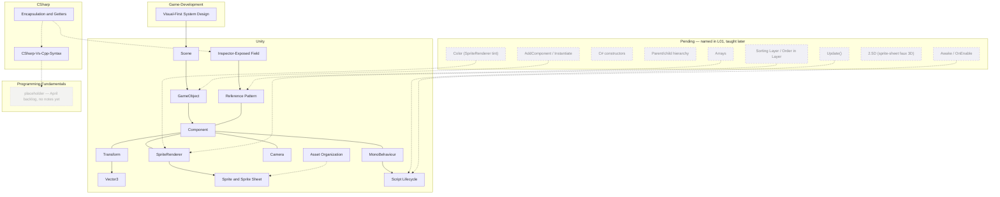

# Map — The Complete Course Concept Graph

> Visual aid only — the real links live in the concept notes. Pending concepts have **no notes
> and no links yet** (registry rule: notes are created only when a lesson actually teaches them).



## Track structure (Phase 2a classification, added 2026-11-18)

All 99 lessons are now classified from transcript content
(`01-Raw-Materials/LESSON-CLASSIFICATION.json`; per-lesson fields in each `metadata.yaml`):

| Track | Lessons | Map |
|---|---|---|
| A — GAME_DEVELOPMENT | 89 | [`map-track-game-development.md`](map-track-game-development.md) |
| B — GAME_DESIGN | 9 | [`map-track-game-design.md`](map-track-game-design.md) |
| C — CROSS_DISCIPLINARY | 1 (L36) | [`map-track-cross-disciplinary.md`](map-track-cross-disciplinary.md) |
| D — UNCLASSIFIED | 0 | — (see `00-Dashboard/UNCLASSIFIED-LESSONS.md`) |

The concept-level graph above (established notes + pending hooks) is unchanged; the track
maps organize the **lesson flow** per track. Dashboard views: `00-Dashboard/COURSE-INDEX.md`.

## Real-links lists

- Unity-side pairs: [`map-unity.md`](map-unity.md)
- C#-side pairs: [`map-csharp.md`](map-csharp.md)
- Track-level lesson flow: [`map-track-game-development.md`](map-track-game-development.md) · [`map-track-game-design.md`](map-track-game-design.md) · [`map-track-cross-disciplinary.md`](map-track-cross-disciplinary.md)
- Pending concepts appear here **only as dashed hooks** — they are deliberately note-less until a
  lesson teaches them (see `concept-registry.md` → *Pending / deferred concepts*).

## Cross-lesson flow (from L01 `06-concept-links.md`)

| Direction | Connection |
|---|---|
| **L02 → builds on** | Reference pattern + classes in Unity; `Update()` begins; arrays enter (instructor's own preview). |
| **L03–L07 → build on** | Mini-game, racing game, Falling Letters — all extend the declare → wire → change loop ("50% of Unity is this only"). |
| **L09 → revisits** | [[Vector3]] — introduced in L01 for scale; deepened for movement math later. |
| **April backlog → feeds** | Inheritance and getters were direct recaps in L01; the C/C++ fundamentals classes precede this module. |

## Learning order (the prerequisite chain taught in L01)

```text
Visual-First System Design
    └─► Scene / GameObject                (the container world)
          └─► Component model             (abilities attach)
                ├─► Transform + Vector3   (space)
                ├─► SpriteRenderer + Sprite/Sheet + Color   (appearance)
                └─► MonoBehaviour + Lifecycle + Start       (executable code)
                      └─► Inspector-Exposed Fields           (public = wireable)
                            └─► Reference Pattern            (declare → wire → change)
                                  └─► One Script, Many Objects  (values decide behavior)
                                        └─► (next) Arrays · Update() · buttons/classes (L02+)
```
