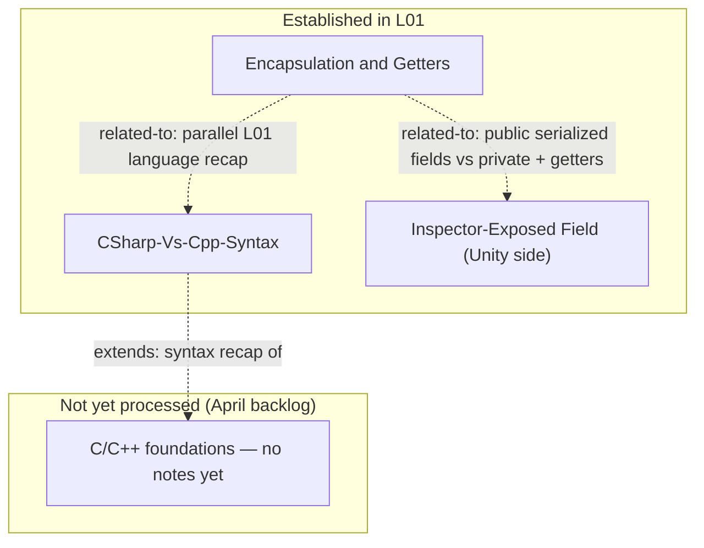

# Map — C# Programming Concepts

> Visual aid only — canonical typed relationships live in the notes:
> [[CSharp-Vs-Cpp-Syntax]] · [[Encapsulation and Getters]].

## Real links (must exist inside the notes)

| From | To | Why this link is real |
|---|---|---|
| [[CSharp-Vs-Cpp-Syntax]] | C/C++ foundations (backlog — **no note yet**) | The five structural differences + "the logics are same — the syntax is different" recapped the earlier C/C++ block; the note extends that material. Dashed: the target note does not exist yet — do **not** create it from memory (Programming-Fundamentals rule). |
| [[Encapsulation and Getters]] | [[CSharp-Vs-Cpp-Syntax]] | Both are L01's C#-language recaps standing apart from the Unity-side concepts; one is about structure transfer, the other about access discipline. |
| [[Encapsulation and Getters]] | [[Inspector-Exposed Field]] | The teaching tension L01 set up: Unity's convention wants `public` serialized fields for Inspector wiring, while C# practice taught here is private data + accessors. |

## Notes

- Only two C# notes are established; both came from L01's recap segments.
- The C/C++ foundations block (Apr 06 → May 05, 2026) will supply the Programming-Fundamentals category (its placeholder README exists) — until then it stays empty and these dashed edges remain unresolvable by design.
