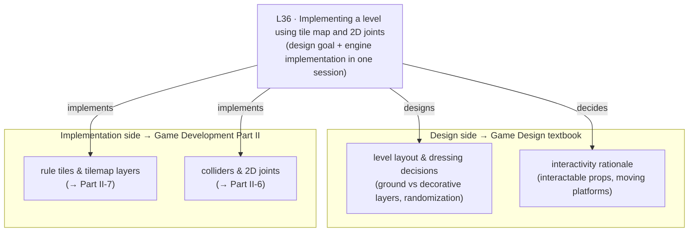

# Map — Track C: Cross-Disciplinary (1 lesson)

> Visual aid only — canonical typed relationships live in the concept notes. The chapter
> outline is [`02-Textbooks/Cross-Disciplinary/README.md`](../../02-Textbooks/Cross-Disciplinary/README.md).
> If this map and a note ever disagree, **the note wins** — update the map.

## Real links (must exist inside the notes)

| From | To | Why this link is real |
|---|---|---|
| L36 | Game-Design Ch 1 / Ch 4 | Design half: "how to use rule tile and how to create a total level design" (00:00:21–00:00:25) is a level-design goal; decorative dressing (00:28:58) and the interactables rationale (01:22:44) are design decisions. |
| L36 | Game-Development Part II-7 / II-6 | Implementation half: rule-tile/tilemap work continues L35's tilemap introduction; joint-based props and platforms extend the L32–L33 colliders-and-joints block. |
| L36 | L35 | Chronological and topical continuation: L35 introduces tilemap + rule tiles; L36 builds the full level with them (explicit "yesterday we were discussing tile map and rule tile" opening). |
| L36 | L32–L33 | The 2D-joints work (hanging/rotating props, moving platforms) applies the joint types taught in L32–L33. |

## Concept placeholders (no notes yet — do not create from memory)

L36's `related_concepts` — Level design implementation · Tilemap layers · Rule tile ·
Sprite randomization · Interactive level props · 2D joints — get notes only when the
introducing lesson (L36 or L35) is processed under the v2 standard
(`03-Knowledge-Graph/concept-registry.md` rule). None of the 17 established notes cover
them yet.

## Boundary notes

- **L08, L18, L72, L75** are *not* Track C: their design content is substantive but
  implementation dominates → Track A with secondary Track B
  ([Game Development Index](../../00-Dashboard/GAME-DEVELOPMENT-INDEX.md)).
- L36 is **MEDIUM** confidence (scattered caption gaps); classification
  (`01-Raw-Materials/LESSON-CLASSIFICATION.json`) and the timestamped evidence in its
  `metadata.yaml` are authoritative over this map.
