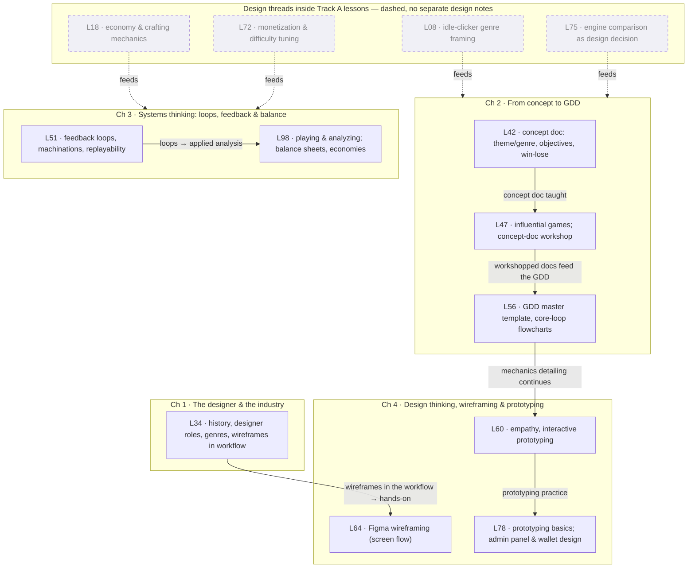

# Map — Track B: Game Design (9 lessons)

> Visual aid only — canonical typed relationships live in the concept notes. Chapter
> groupings follow [`02-Textbooks/Game-Design/README.md`](../../02-Textbooks/Game-Design/README.md).
> If this map and a note ever disagree, **the note wins** — update the map.

## Real links (must exist inside the notes)

These are **lesson-level** links; they will be carried by the lessons' own
`06-concept-links.md` tables and the textbook chapters as those are produced. Targets do
not exist as notes yet — do not create them from memory (registry rule).

| From | To | Why this link is real |
|---|---|---|
| L34 | L64 | L34 places wireframes in the design workflow; L64 executes wireframing hands-on in Figma (screen flow, prototype linking). |
| L42 | L47 | L42 teaches the concept document (theme, genre, objectives, actions, win/lose); L47 is its workshop: "practical concept document workshop; reviewing theme, genre, objective and actions". |
| L47 | L56 | L56 formalizes the document hierarchy "concept doc to GDD" via the master template — the direct continuation of L47's reviewed concepts. |
| L56 | L60 | L60 opens still inside GDD mechanics detailing (combat, inventory, ranged/melee) before moving to design thinking. |
| L60 | L78 | L60 introduces design thinking + interactive prototyping; L78 is prototyping practice (wireframes, admin-panel design). |
| L51 | L98 | L51's feedback loops / core-loop analysis / machinations are re-applied in L98's "core loop analysis of played games" and balance sheets. |
| L08 (Track A) | Ch 2–3 | Idle-clicker genre & upgrade-mechanics framing — design content inside a development lesson. |
| L75 (Track A) | Ch 2 | Engine comparison as a design decision (Unity vs Unreal capabilities). |
| L18 (Track A) | Ch 3 | Accumulation/economy and crafting-recipe mechanics reasoning. |
| L72 (Track A) | Ch 3 | Monetization (ads vs in-app) and analytics-driven difficulty tuning. |
| L36 (Track C) | Ch 1, Ch 4 | Level-design decisions inside engine implementation — bridged via [`map-track-cross-disciplinary.md`](map-track-cross-disciplinary.md). |

## Notes

- **Chronology:** the 9 lessons interleave with Track A across the whole course —
  L34 (2026-07-03) sits inside the Unity block; L98 (2026-11-09) lands during the OpenGL
  block. The chapter grouping is thematic; see the
  [Game Design Index](../../00-Dashboard/GAME-DESIGN-INDEX.md) for the true order.
- **MEDIUM-confidence lessons:** L64 (captions start 04:02 + ~45-min gap; content is
  Figma wireframing despite the "Idea Generation Techniques" title) and L78 (planned
  animation-blueprint segment deferred; content is wireframes + admin-panel/wallet design).
- **No concept notes yet:** none of these lessons have been processed under the v2
  standard (L01 is the only processed lesson) — concept nodes appear here as lesson
  labels, not as `[[wiki-links]]`, until the introducing lessons create real notes.
