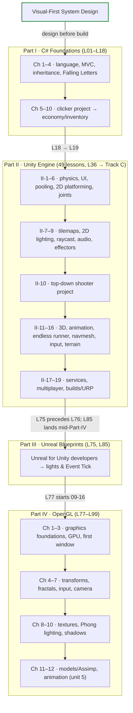

# Map — Track A: Game Development (89 lessons)

> Visual aid only — canonical typed relationships live in the concept notes. Chapter
> groupings follow [`02-Textbooks/Game-Development/README.md`](../../02-Textbooks/Game-Development/README.md).
> If this map and a note ever disagree, **the note wins** — update the map.
> Concept-level links (GameObject/Component family, C# recaps) live in
> [`map-unity.md`](map-unity.md) and [`map-csharp.md`](map-csharp.md); this map adds the
> track-level lesson flow across the four subject blocks.

## Real links (must exist inside the notes)

Concept-note links are tabulated in [`map-unity.md`](map-unity.md) (13 Unity notes),
[`map-csharp.md`](map-csharp.md) (2 C# notes) and [`map-course.md`](map-course.md) — not
repeated here. The pairs below are **cross-subject bridges** the notes must carry once
the involved lessons are processed; targets marked ◇ do **not** exist yet — do not create
them from memory (registry rule).

| From | To | Why this link is real |
|---|---|---|
| [[Script Lifecycle]] | ◇ Unity lifecycle deepening (L19: Awake/Start/Update/FixedUpdate with physics) | L19's topics explicitly extend the L01 lifecycle into FixedUpdate/physics territory. |
| [[Inspector-Exposed Field]] | ◇ SerializeField exposure pattern (L03, L19) | `SerializeField` vs public exposure is taught in both blocks; the note must gain the L19 refinement. |
| [[Vector3]] | ◇ GLM matrix-vector transforms (L83) | Same translation/rotation/scale math, different language/runtime (C# struct vs C++/GLM). Stays **separate** notes until a lesson forces a merge — related, not identical. |
| ◇ Unity light baking/optimization (L55, L57) | ◇ GPU architecture & draw-call cost (L80) | Both teach the performance story: L55 baked-vs-real-time on Unity's side; L80 command buffers/draw calls/overdraw on the GPU side. Related concepts, separate notes per engine. |
| ◇ Unity materials & textures (L53) | ◇ OpenGL textures (L88–L89) | "Texture as image on a surface" family; Unity teaches UV/material workflow, OpenGL teaches texels/wrapping/filtering — related, separate notes. |
| ◇ Unity animation (L30, L58–L59) | ◇ OpenGL animation principles (L99) | L99 opens OpenGL unit 5 with keyframes/interpolation — the concept family Unity already taught in its own terms. |
| ◇ Unity services (L72) | ◇ Multiplayer lobby service (L74) | Both lessons initialize Unity Services; L74 builds on L72's `InitializeAsync` setup. |
| ◇ Object pooling (L25, L44, L61) | ◇ pooling reuse across projects | Queue-based path recycling in L61 re-applies the L25 pattern in a 3D runner — same pattern, second occurrence. |

## Notes

- **Composition:** 89 lessons = 18 C# (L01–L18) + 49 Unity (L19–L76 minus L36) + 2 Unreal
  (L75, L85) + 20 OpenGL (L77–L84, L86–L99). L36 is the one Unity-subject lesson classified
  CROSS_DISCIPLINARY → [`map-track-cross-disciplinary.md`](map-track-cross-disciplinary.md).
- **Chronology vs parts:** Part III is interleaved, not sequential — L75 (2026-09-13) falls
  between II-18 (L73–L74) and II-19 (L76, 2026-09-15); L85 (2026-10-09) lands inside Part
  IV (between L84 and L86). The diagram's edges carry this as a caption.
- **MEDIUM-confidence lessons in this track:** L11 (20-minute fragment — folds into
  textbook Ch 6), L75 (scattered caption gaps). Coverage caveats: L55/L65 captions end
  early; L96 starts 04:04, L99 starts 06:37.
- Secondary design threads (L08, L18, L72, L75) are tracked in
  [`map-track-game-design.md`](map-track-game-design.md), not here.
