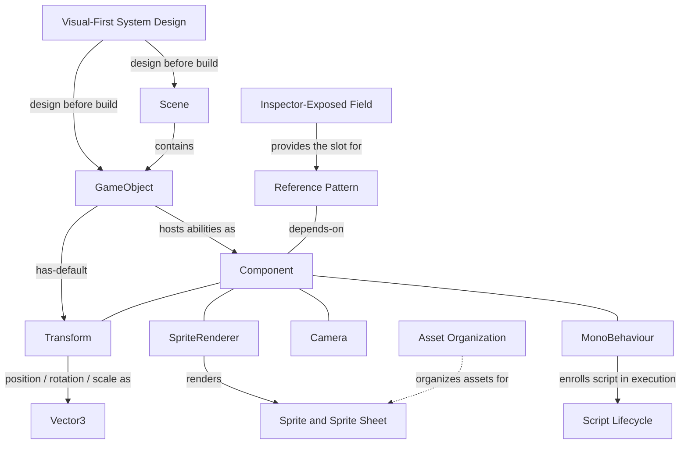

# Map — Unity Engine Concepts

> Visual aid only — canonical typed relationships live in each note's *Relationships* section.
> Edge labels are descriptive captions, not the canonical types.

## Real links (must exist inside the notes)

Source of justifications: L01 `06-concept-links.md` detailed-links table.

| From | To | Why this link is real |
|---|---|---|
| [[Visual-First System Design]] | [[Scene]] · [[GameObject]] | Sketch → translate visuals into values/functions → list interactions → build; the design step precedes all practical building (prerequisite-chain top). |
| [[Scene]] | [[GameObject]] | Objects live *inside* scenes; the scene is the container the Hierarchy displays (menu / gameplay / boss-fight partitions). |
| [[GameObject]] | [[Transform]] | Every GameObject ships with exactly one Transform — non-removable, because something must define where it exists. |
| [[GameObject]] | [[Component]] | Abilities attach as components; "behaviors are nothing but the code"; an empty GameObject = only Transform. |
| [[Component]] | [[Transform]] · [[SpriteRenderer]] · [[Camera]] · [[MonoBehaviour]] | All of these ARE components — live objects of classes attached to GameObjects, shown by the Inspector. |
| [[MonoBehaviour]] | [[Script Lifecycle]] | Inheriting MonoBehaviour enrolls the script in Unity's execution ("Unity will only execute any function extending from this MonoBehaviour, attached to the particular game object"). |
| [[Script Lifecycle]] | Start hook (Awake → OnEnable → Start → frame loop) | The lifecycle begins with the setup hooks; `Update()` deliberately deferred to L02. |
| [[Transform]] | [[Vector3]] | Position / rotation (Euler) / scale are stored as three-number `Vector3` values; `new Vector3(s, s, s)` is the uniform-scale idiom. |
| [[SpriteRenderer]] | [[Sprite and Sprite Sheet]] | The component draws the image asset; Sprite Mode Single/Multiple selects the frame. |
| [[SpriteRenderer]] | Color (tint) | `color` acts as multiply-overlay; white = unchanged; alpha = transparency. (Color has **no note yet** — registry pending.) |
| [[Inspector-Exposed Field]] | [[Reference Pattern]] | No public slot → no wiring → no control (`depends-on` direction: Reference Pattern depends on the field). |
| [[Reference Pattern]] | [[Component]] | Can't reference what isn't a component. |
| [[Asset Organization]] | [[Sprite and Sprite Sheet]] | Art-folder habit, import settings, `.meta` identity support the sprite pipeline. |

## Notes

- **Camera** currently links only through the Component family — L01 established it as "the component whose view *is* the Game view".
- **Script Lifecycle** covers Awake/OnEnable inside its note (see registry pending list — standalone notes only if a later lesson requires them).
- Pending concepts (`Update()`, arrays, sorting layers, Color) are **not** in this map's real-links list as note links — they have no notes yet.
