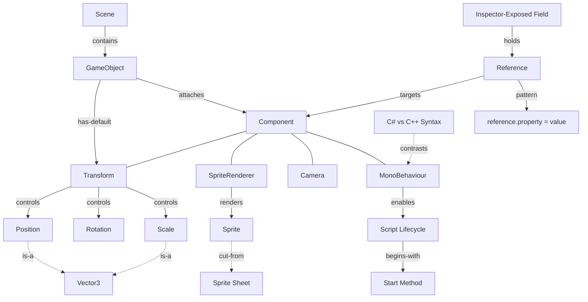

# L01 — Concept Links (Knowledge Graph)

| | |
|---|---|
| **Lesson** | L01 — Introduction to C# · Batch 01 |
| **What this is** | The lesson's **subject knowledge** as a concept graph — not the sequence of the video. Each concept has a full note in the vault root: `concepts/<Name>.md`. |
| **Relationship types** | contains · part-of · has-default · controls · renders · enables · depends-on · prerequisite-for · related · contrasted-with · continuation-of |

## Graph overview



## Detailed links

| From | Relationship | To | Why this link is real |
|---|---|---|---|
| **Scene** | contains | GameObject | Objects live *inside* scenes; the scene is the container the Hierarchy displays (menu / gameplay / boss-fight partitions) |
| **GameObject** | has-default | Transform | Every GameObject ships with exactly one Transform — non-removable, because something must define where it exists |
| **GameObject** | part-of-composition | Component | Abilities attach as components; "behaviors are nothing but the code"; empty GameObject = only Transform |
| **Component** | is-object-of | Class | "Whatever you add on any game object becomes a reference of that particular class" — the Inspector shows live objects of classes |
| **Transform** | controls | Position | Spatial ownership; all changes "go and ask the transform" |
| **Transform** | controls | Rotation | Orientation; Euler degrees in Inspector, quaternion internally |
| **Transform** | controls | Scale | Size multipliers per axis; `localScale` writable, `lossyScale` world-accumulated |
| **Position** | is-stored-as | Vector3 | Three-number type for X/Y/Z; same for scale and Euler rotation |
| **Scale** | is-stored-as | Vector3 | `new Vector3(s, s, s)` = uniform scale idiom |
| **SpriteRenderer** | renders | Sprite | The component draws the image asset; asset vs component distinction |
| **Sprite** | is-cut-from | Sprite Sheet | Sheets hold all animation frames; slicing produces frame sprites; Sprite Mode Single/Multiple is the switch |
| **SpriteRenderer** | is-tinted-by | Color | `color` acts as multiply-overlay; white = unchanged; alpha = transparency |
| **MonoBehaviour** | enables | Script Lifecycle | Inheriting it enrolls the script in Unity's execution: "Unity will only execute any function extending from this MonoBehaviour, attached to the particular game object" |
| **Script Lifecycle** | begins-with | Start Method | `Awake` → `OnEnable` → `Start` → per-frame loop (`Update`, L02) → disable/destroy; Start = the beginner's setup hook |
| **Inspector-Exposed Field** | holds | Reference | `public` field = the seat; serialization is what makes the slot exist and persist |
| **Reference** | provides-access-to | Component | Stored reference = the address code talks to; unwired = `null` → NullReferenceException |
| **Reference** | enables | `reference.property = value` | The lesson's universal pattern: scale, sprite, color all through wired references |
| **Reference Pattern** | depends-on | Inspector-Exposed Field | No slot → no wiring → no control |
| **Reference Pattern** | depends-on | Component model | Can't reference what isn't a component |
| **Reference Pattern** | prerequisite-for | One-script-many-objects | Per-copy field values = per-object behavior; arrays later |
| **Asset Organization** | supports | Asset/Sprite pipeline | Art-folder habit; import settings; `.meta` identity |
| **C# vs C++ Syntax** | continuation-of | C/C++ foundations | Five differences + "the logics are same — the syntax is different" |
| **System Design (visual first)** | prerequisite-for | Everything practical | Sketch → translate visuals into values/functions → list interactions → build |

## Prerequisite chain (learning order)

```
System Design (visual first)
    └─► Scene / GameObject                (the container world)
          └─► Component model             (abilities attach)
                ├─► Transform + Vector3   (space)
                ├─► SpriteRenderer + Sprite/Sheet + Color   (appearance)
                └─► MonoBehaviour + Lifecycle + Start       (executable code)
                      └─► Inspector-Exposed Fields           (public = wireable)
                            └─► Reference Pattern            (declare → wire → change)
                                  └─► One Script, Many Objects  (values decide behavior)
                                        └─► (next) Arrays · Update() · buttons/classes (L02+)
```

## Concept notes (vault root: `concepts/`)

| Note | One-line summary |
|---|---|
| [[GameObject]] | The empty container whose abilities come entirely from attached components |
| [[Component]] | An object of a class attached to a GameObject — Unity's "behavior" |
| [[Transform]] | The permanent spatial component: position, rotation, scale |
| [[Vector3]] | The three-float value type behind position/scale/rotation — not a C++ vector |
| [[SpriteRenderer]] | The component that draws a sprite and takes its tint |
| [[Sprite and Sprite Sheet]] | Image assets: single images vs packed frames, slicing, Sprite Mode |
| [[Scene]] | The container of GameObjects — one "part" of a game |
| [[Camera]] | The component whose view *is* the Game view |
| [[MonoBehaviour]] | The base class that makes scripts executable Unity behaviors |
| [[Script Lifecycle]] | Awake → OnEnable → Start → frame loop → disable/destroy |
| [[Inspector-Exposed Field]] | `public` fields as serialized, wireable Inspector slots |
| [[Reference Pattern]] | Declare a seat → wire it → `reference.property = value` |
| [[CSharp-Vs-Cpp-Syntax]] | The five structural differences + what transfers unchanged |
| [[Encapsulation and Getters]] | Private data, public accessors, C# properties |
| [[Asset Organization]] | Folders-first importing and why it scales |

## Cross-lesson links

| Direction | Connection |
|---|---|
| **L02 → builds on** | The reference pattern + classes in Unity: the instructor's own preview — "a nice game tomorrow with a button… how do I make use of classes in C# in Unity"; `Update()` begins; arrays enter |
| **L03–L07 → build on** | Mini-game, racing game, Falling Letters — all extend the declare→wire→change loop ("50% of Unity is this only") |
| **L09 → revisits** | Vector3 — introduced here for scale; deepened for movement math later |
| **April backlog → feeds** | Inheritance and getters were direct recaps; the C/C++ fundamentals classes precede this module |

## Deliberately-open threads (from this lesson)

- **`Update()`** — named, deferred to L02 (the every-frame hook).
- **Arrays** — named as the better multi-object solution ("the best way to do is using arrays"), taught later.
- **Parent/child hierarchy** — dismissed for the one-script problem ("nothing will happen"), explanation deferred.
- **Constructors in C#** — deferred ("completely different").
- **`lossyScale`** — mentioned and waved off; explained in [[Transform]] for completeness.
- **On-screen identifiers** (`sparksTransform`? `shrinkSize`, `mySR`) — spellings reconstructed; see `08-source-reference.md`.
